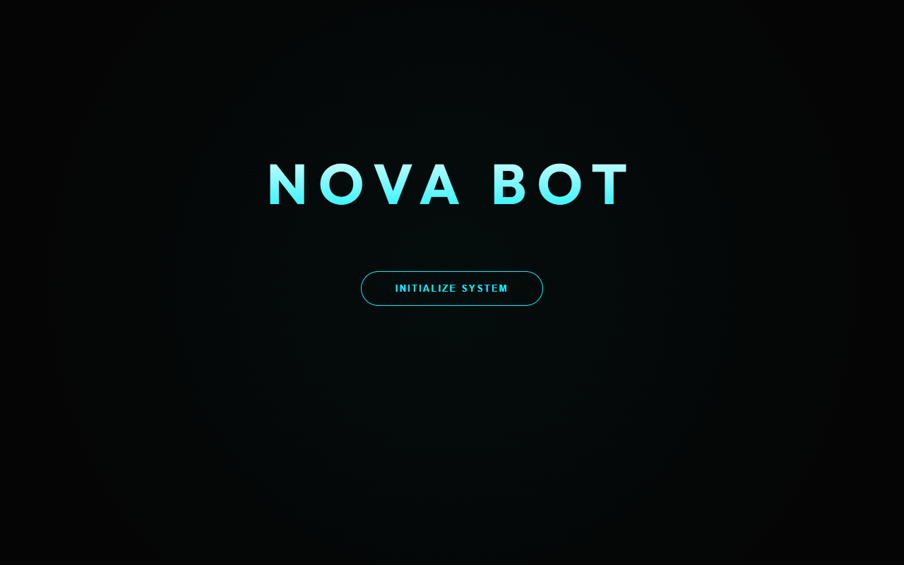
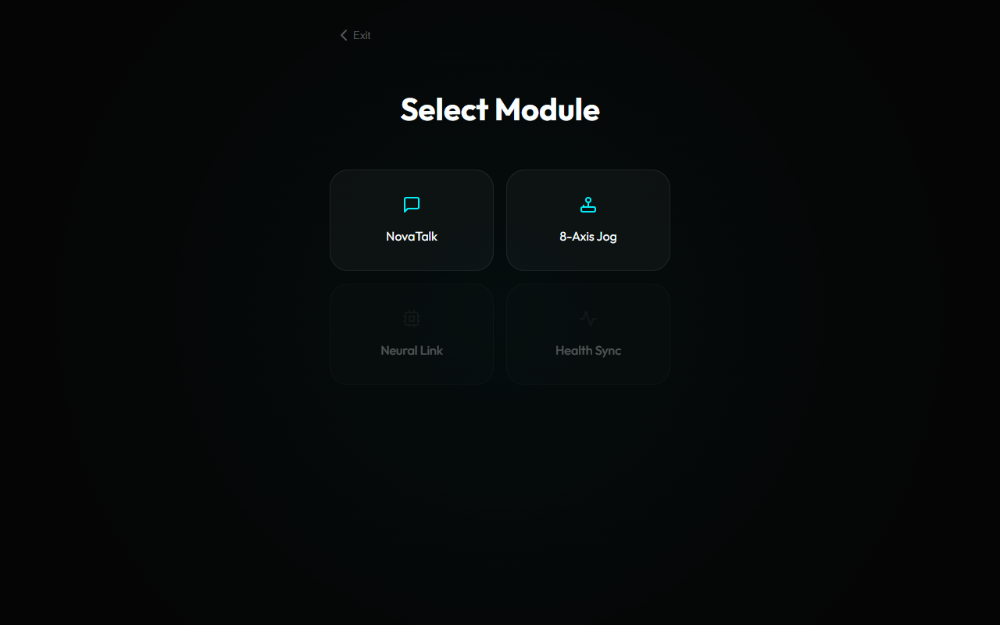
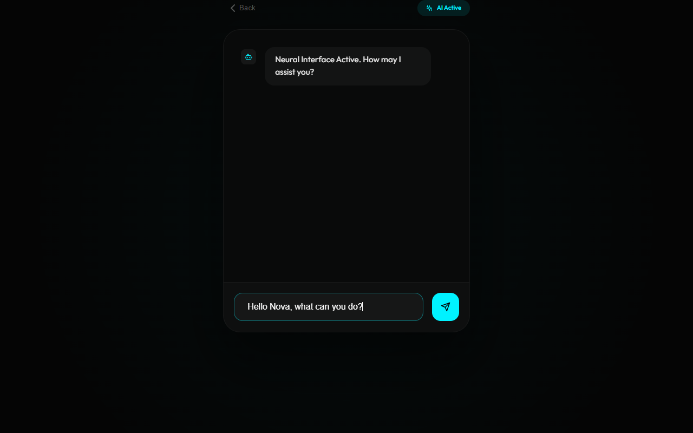
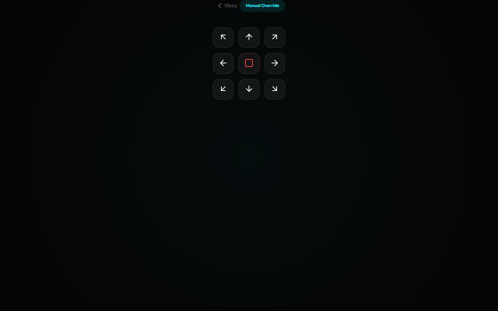
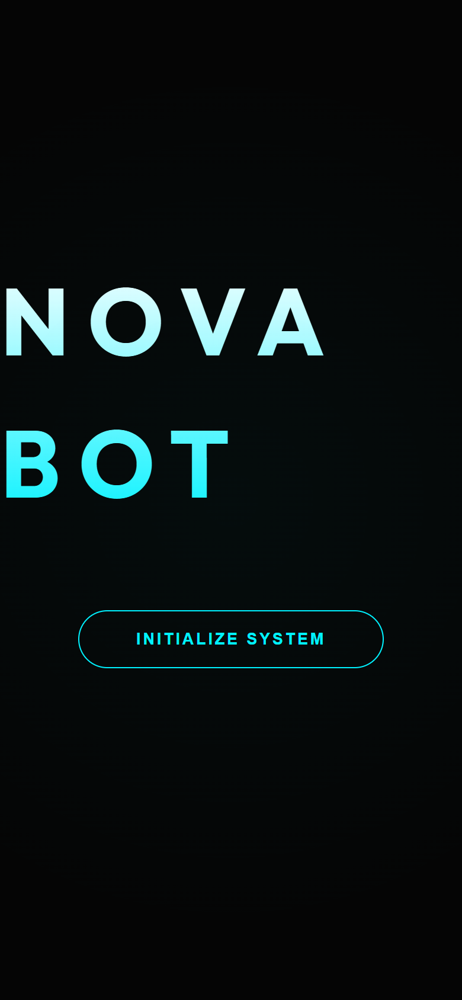
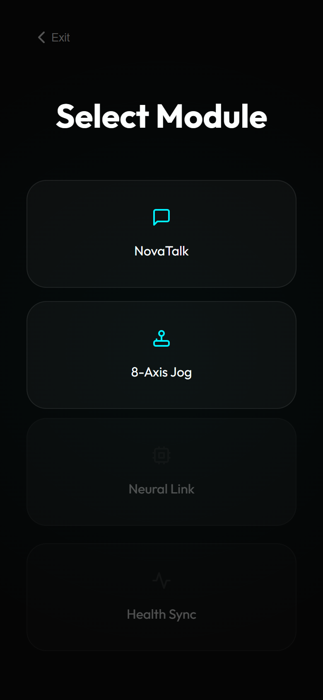
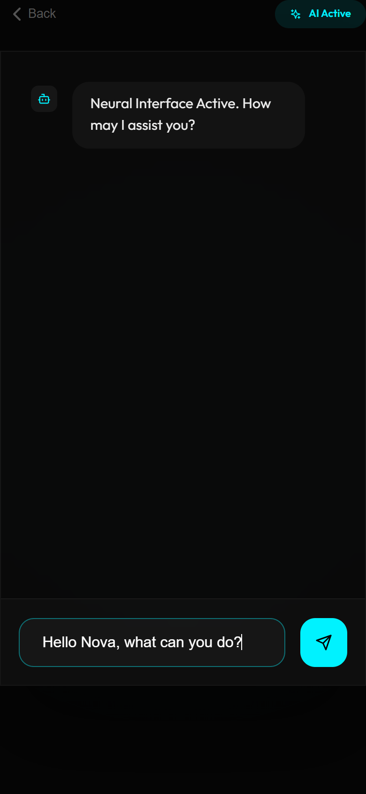
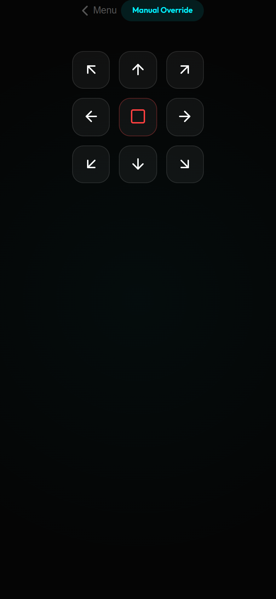

# 🤖 Nova Bot Pro

**Control a Wi-Fi robot from your browser and chat with it using AI.**

Nova Bot Pro has two parts:

1. **A web control panel**: a dark, animated React app. It has an AI chat module called **NovaTalk**, which speaks its replies aloud, and an **8-direction jog pad** for driving the robot by hand.
2. **ESP32 firmware** (`mainsketch/mainsketch.ino`): it connects the robot to Wi-Fi, watches Firebase for new commands and drives two DC motors through an H-bridge.

The website and the robot never talk to each other directly. **Firebase Realtime Database** sits between them, so you can control the robot from any device and any network.

---

## 📸 Screenshots

### Boot sequence
When the app opens, it plays a short animated start-up sequence (about 5.5 seconds) before the landing screen appears.

| 1. Scanning | 2. Loading neural core | 3. Online |
|---|---|---|
|  |  |  |

### Landing page


### Module menu
**NovaTalk** and **8-Axis Jog** work today. **Neural Link** and **Health Sync** are placeholders for future modules and are disabled.



### NovaTalk: AI chat


### 8-Axis Jog: manual drive


### On mobile
The layout adapts to phone screens, so you can drive the robot from your phone.

| Landing | Menu | NovaTalk | Jog |
|---|---|---|---|
|  |  |  |  |

---

## ✨ Features

| Feature | Description |
|---|---|
| 🎬 **Animated boot-up** | A three-stage intro animation built with Framer Motion. |
| 💬 **NovaTalk AI chat** | Runs on **Llama 3.1 8B Instant** through the Groq API and sends the last 6 messages as context. |
| 🔊 **Voice replies** | Reads each AI answer aloud with the browser's built-in **Web Speech API** (`speechSynthesis`). |
| 🕹️ **8-direction jog pad** | N, NE, E, SE, S, SW, W and NW, plus a STOP button. The robot moves **while you hold a button** and stops when you let go. Works with both mouse and touch. |
| ☁️ **Cloud control** | Commands go through Firebase Realtime Database, so the robot works from anywhere with internet. |
| 💓 **Heartbeat** | The ESP32 writes `Online` to Firebase every 4 seconds. |
| 📱 **Responsive UI** | Dark glass-style theme that also fits phone screens. |

---

## 🏗️ How it works

```
┌──────────────────────┐        write         ┌───────────────────────────┐        poll         ┌──────────────────────┐
│   React Web App       │ ───────────────────▶ │  Firebase Realtime DB      │ ◀────────────────── │       ESP32           │
│  (Vite, browser)      │  /commands           │                           │  /commands/command  │  mainsketch.ino       │
│                       │  {command,timestamp} │  /commands                │                     │                      │
│  • Jog pad            │                      │  /botStatus/status        │ ◀────────────────── │  • Reads command      │
│  • NovaTalk chat ─────┼──▶ Groq API          │                           │   write "Online"    │  • Drives motors      │
│    (Llama 3.1)        │   (AI replies)       │                           │   every 4 s         │  • Heartbeat          │
└──────────────────────┘                      └───────────────────────────┘                     └──────────┬───────────┘
                                                                                                           │ PWM
                                                                                                           ▼
                                                                                               ┌──────────────────────┐
                                                                                               │ H-bridge motor driver │
                                                                                               │  → Left & Right motor │
                                                                                               └──────────────────────┘
```

### Command flow (jog)
1. You **press and hold** an arrow, for example ↑. The app writes `{ command: "N", timestamp }` to `/commands`.
2. The ESP32 loop reads `/commands/command`. If the value is **different from the last one**, it runs the matching motor action.
3. When you **release** the button, the app writes `STOP` and the motors stop.

### Command flow (NovaTalk)
1. You type a message. The app sends it, along with the last 6 messages, to Groq (`llama-3.1-8b-instant`) with a short system prompt: *"You are Nova Bot. Short, professional AI."*
2. The reply appears in the chat and is **spoken aloud**.
3. The app also logs `AI: <your message>` to `/commands`. The ESP32 ignores any command it doesn't recognise, so this never moves the robot.

### Firebase data structure
```json
{
  "commands":  { "command": "N", "timestamp": 1713945600000 },
  "botStatus": { "status": "Online" }
}
```

---

## 🎮 Command reference

The firmware sets four PWM pins, one per motor direction (values 0–255):

| Button | Command | Motion | L_FOR | L_REV | R_FOR | R_REV |
|:---:|:---:|---|:---:|:---:|:---:|:---:|
| ↑ | `N` | Forward | 0 | 220 | 0 | 220 |
| ↓ | `S` | Backward | 220 | 0 | 220 | 0 |
| ← | `W` | Spin left | 0 | 220 | 220 | 0 |
| → | `E` | Spin right | 220 | 0 | 0 | 220 |
| ↖ | `NW` | Curve forward-left | 0 | 220 | 0 | 110 |
| ↗ | `NE` | Curve forward-right | 0 | 110 | 0 | 220 |
| ↙ | `SW` | Curve back-left | 220 | 0 | 110 | 0 |
| ↘ | `SE` | Curve back-right | 110 | 0 | 220 | 0 |
| ■ | `STOP` | Stop | 0 | 0 | 0 | 0 |

> The diagonal moves run one wheel at full speed (220) and the other at half speed (110), so the robot drives in a curve.
> If your robot goes the wrong way, swap the motor wires or swap the `FOR`/`REV` pin numbers in the sketch.

---

## 🔌 Hardware

| Part | Notes |
|---|---|
| ESP32 dev board | Any ESP32 with Wi-Fi |
| Dual H-bridge motor driver | For example L298N, L9110S or TB6612FNG |
| 2 × DC gear motors + chassis | Differential (tank-style) drive |
| Battery pack | Power the motors separately from the ESP32's USB, and **connect the grounds together** |

### Wiring

| ESP32 pin | Connects to |
|:---:|---|
| GPIO **25** | Left motor, forward (`L_FOR`) |
| GPIO **26** | Left motor, reverse (`L_REV`) |
| GPIO **27** | Right motor, forward (`R_FOR`) |
| GPIO **14** | Right motor, reverse (`R_REV`) |
| GPIO **2** | Status LED (built-in on most boards) |
| GND | Driver GND (shared ground) |

**What the LED means:** 3 quick blinks = booting. Stays on = connected to Wi-Fi and Firebase, waiting for commands.

---

## 📁 Project structure

```
Novabotv1/
├── index.html              # HTML entry point (page title "Nova Bot Pro")
├── package.json            # Dependencies and npm scripts
├── vite.config.js          # Vite + React plugin
├── mainsketch/
│   └── mainsketch.ino      # ESP32 firmware (Wi-Fi + Firebase + motor control)
├── src/
│   ├── main.jsx            # Mounts the React app
│   ├── App.jsx             # Every screen: boot, landing, menu, NovaTalk, jog
│   ├── App.css             # Component styles (glass UI, chat, jog grid)
│   ├── index.css           # Global styles, Outfit font, dark theme
│   └── firebase.js         # Firebase setup → exports `db`
└── docs/
    └── screenshots/        # Images used in this README
```

The app has no router. `App.jsx` switches between screens with a single `screen` state value: `bootup → landing → menu → novatalk | jog`.

---

## 🛠️ Tech stack

**Frontend:** React 18 · Vite 5 · Framer Motion · Lucide icons · Firebase JS SDK v10 · Web Speech API
**AI:** Groq API · Meta Llama 3.1 8B Instant
**Backend:** Firebase Realtime Database
**Firmware:** Arduino (ESP32 core) · [Firebase ESP32 Client](https://github.com/mobizt/Firebase-ESP32) by Mobizt

---

## 🚀 Getting started

### 1. Firebase
1. Create a project in the [Firebase console](https://console.firebase.google.com/) and add a **Realtime Database**.
2. For quick testing, start it in **test mode**. Before you use it for real, lock it down (see [Security notes](#-security-notes)).
3. Copy your web config into `src/firebase.js`, and copy your API key and database URL into the sketch.

### 2. Web app
```bash
git clone https://github.com/ArchitYadav07/Novabotv1.git
cd Novabotv1
npm install
npm run dev        # http://localhost:5173
```
Other scripts:
```bash
npm run build      # production build → dist/
npm run preview    # serve the production build locally
```
NovaTalk needs a [Groq API key](https://console.groq.com/keys). Set it in `src/App.jsx` (`GROQ_API_KEY`). Better: move it to a `.env` file, as described below.

**Deploying:** `dist/` is a static site, so it runs on Netlify, Vercel, Firebase Hosting or GitHub Pages.

### 3. ESP32 firmware
1. Install the **ESP32 board package** in the Arduino IDE (Boards Manager → "esp32" by Espressif).
2. Install the **Firebase ESP32 Client** library by Mobizt (Library Manager).
3. Open `mainsketch/mainsketch.ino` and set:
   ```cpp
   const char* WIFI_SSID     = "your-wifi";
   const char* WIFI_PASSWORD = "your-password";
   #define API_KEY      "your-firebase-web-api-key"
   #define DATABASE_URL "your-project-default-rtdb.firebaseio.com"   // no https://, no trailing slash
   ```
4. Upload the sketch and open the Serial Monitor at **115200 baud**. You should see:
   ```
   --- NOVA BOT CLOUD STARTING ---
   ....
   Wi-Fi [CONNECTED]
   SYSTEM READY: Listening for Netlify Commands...
   CLOUD SIGNAL RECEIVED: N
   >>> MOTOR ACTION: FORWARD
   ```

---

## 🧯 Troubleshooting

| Problem | Fix |
|---|---|
| `Failed to initialize the SSL layer` | The sketch already calls `fbdo.setBSSLBufferSize(1024, 1024)`. Also check that the board has enough free memory. |
| ESP32 never gets any commands | `DATABASE_URL` must **not** include `https://` or a trailing `/`. Check that your database rules allow reads. |
| Robot moves the wrong way | Swap the motor wires, or swap the `L_FOR`/`L_REV` (or `R_FOR`/`R_REV`) pin numbers. |
| Robot won't move after you repeat a command | The firmware only acts when the command **changes**. Release the button (which sends `STOP`) before pressing it again. |
| NovaTalk says *"Connection logic failed."* | Check the Groq API key, your internet connection and Groq's rate limits. |
| No voice | Some browsers need you to click or tap the page before `speechSynthesis` will play. |

---

## 🔐 Security notes

Before you make this public or put the robot somewhere shared:

- **Don't hard-code API keys in frontend code.** Anything in `src/` ships to every visitor's browser. Move the Groq key into a Vite env var (`.env` → `VITE_GROQ_API_KEY`, read with `import.meta.env.VITE_GROQ_API_KEY`). Even then, a key used in the browser is still visible to visitors. The safe setup is a small backend or serverless function that calls Groq for you. **If a key has ever been committed, revoke it and create a new one.**
- **Lock down Firebase rules.** In test mode, anyone who knows the database URL can drive your robot. Add Firebase Authentication and rules that only let signed-in users write to `/commands`.
- **Keep Wi-Fi credentials out of git.** Put them in a separate `secrets.h` file and add that file to `.gitignore`.

---

## 🗺️ Roadmap

- [ ] **Neural Link** module (currently a disabled placeholder)
- [ ] **Health Sync** module, e.g. battery level and live `botStatus` shown in the UI
- [ ] Voice *commands* (speech-to-text → robot actions)
- [ ] Let the AI turn chat requests into motor commands
- [ ] Speed slider for the jog pad

---

## 👤 Author

**Archit Yadav** · [@ArchitYadav07](https://github.com/ArchitYadav07)
